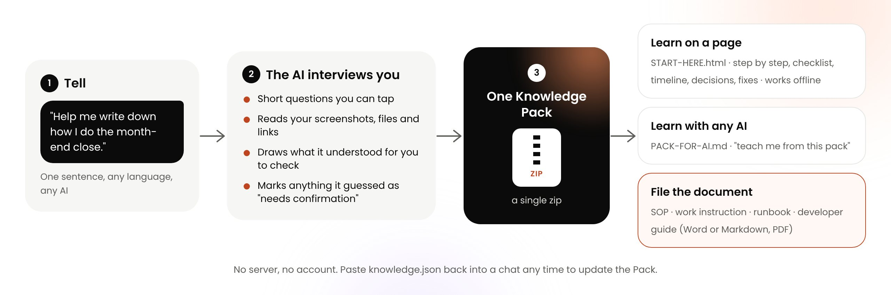
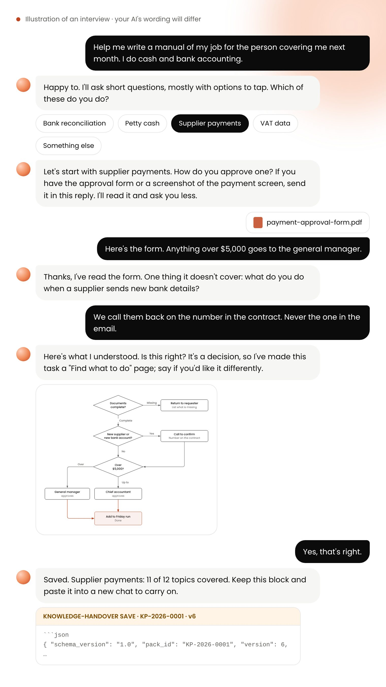
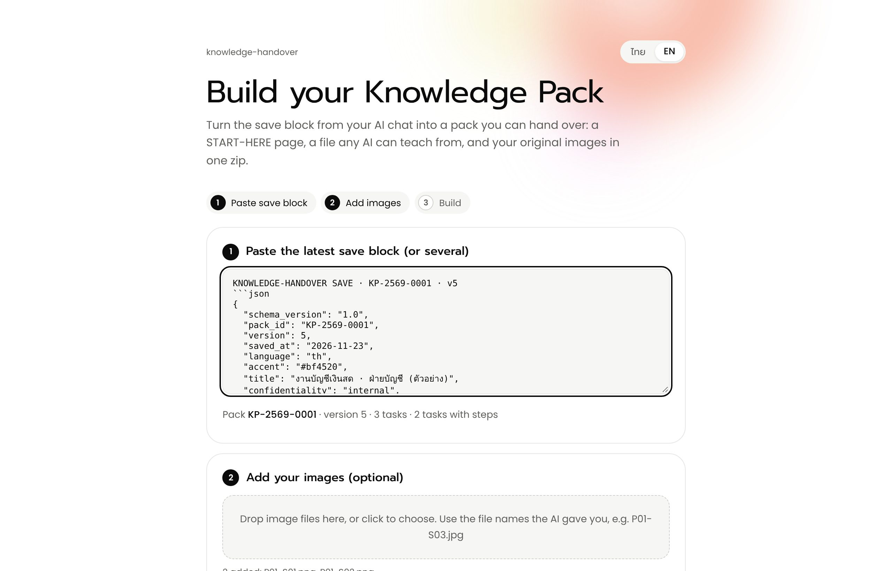
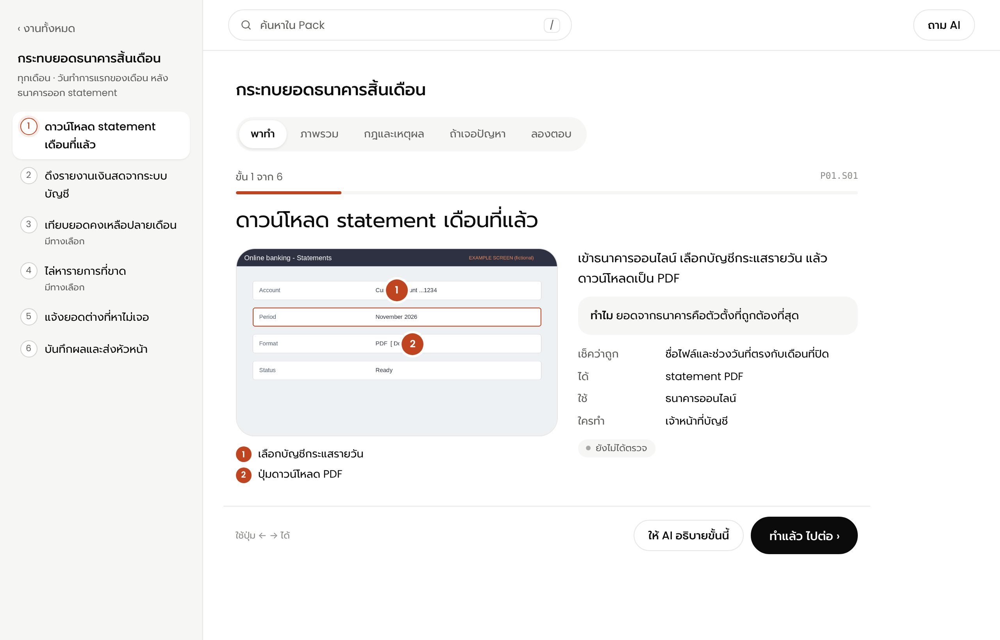
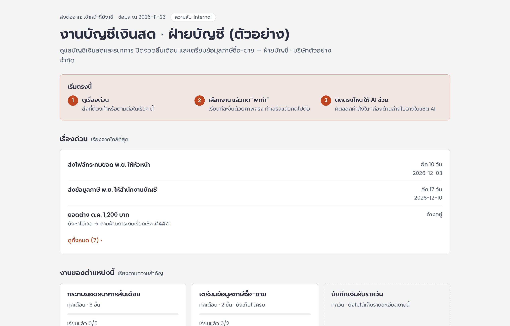
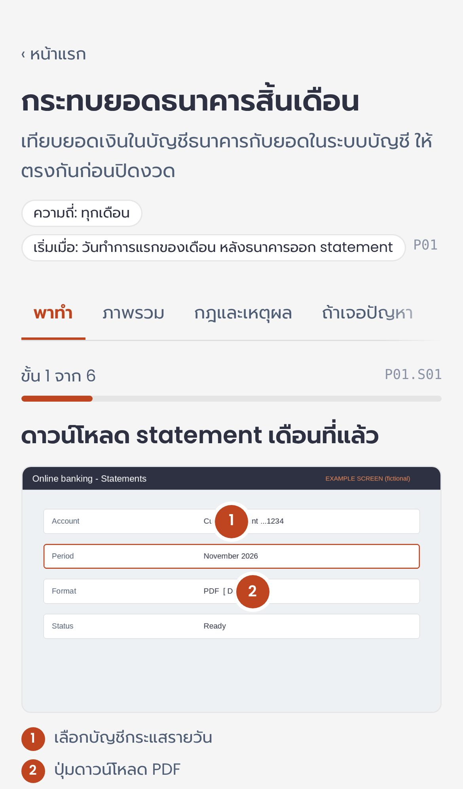
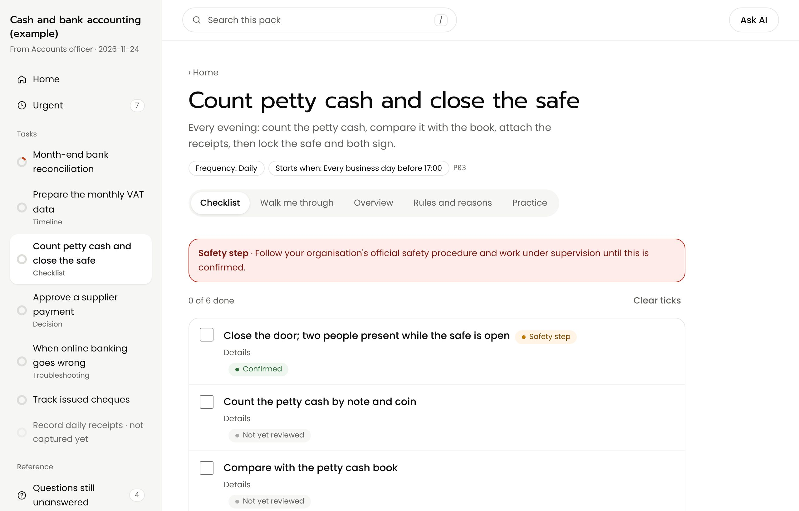
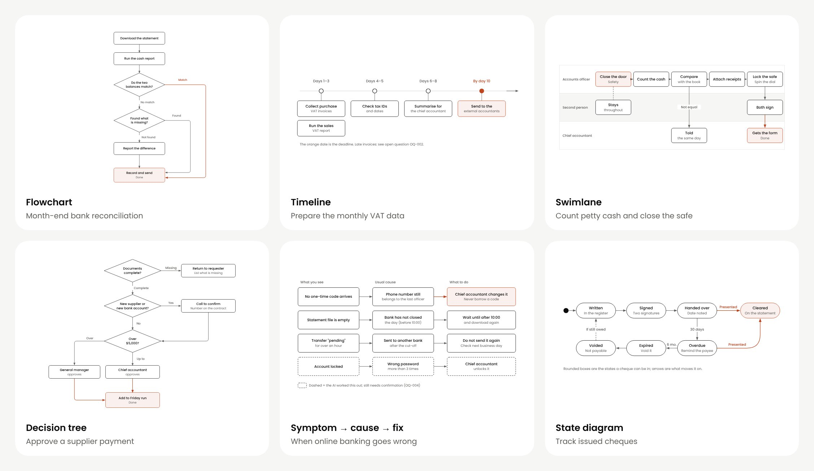
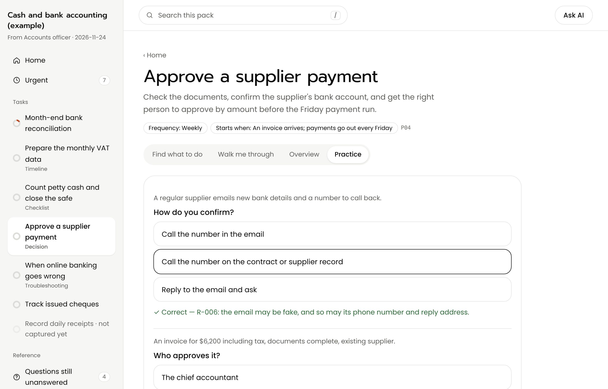
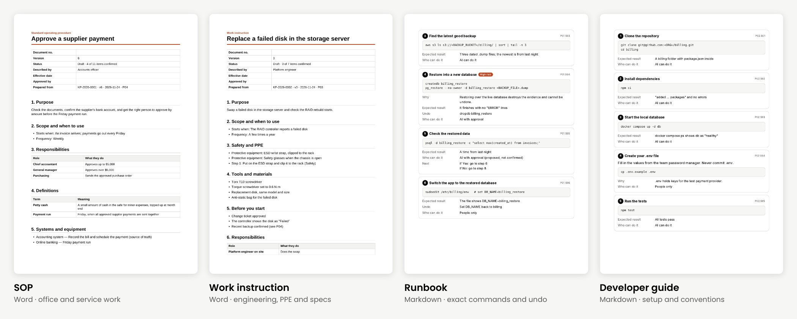

<div align="center">


# knowledge-handover

**Your know-how, ready to pass on.**

An AI skill that interviews someone about how they really do their job, then turns it into one **Knowledge Pack**: a page anyone can learn from in a browser, a file any AI can teach from, and the document your line of work files (SOP, work instruction, runbook or developer guide).

**English** · [ภาษาไทย](README.th.md)

[](https://github.com/phumminbm/knowledge-handover/actions/workflows/ci.yml)
[](https://github.com/phumminbm/knowledge-handover/releases/latest)
[](LICENSE)

[How it works](#how-it-works) · [What you get](#what-you-get) · [Examples](#see-the-examples) · [Install](#install) · [Pack Builder](https://phumminbm.github.io/knowledge-handover/) · [Help](#if-something-goes-wrong)



</div>

## Why

Work manuals are usually written in a rush, miss the exceptions, and nobody knows which parts are still true. That holds for a new-hire guide, a stand-in's notes, a team SOP, a handover and the knowledge base for an AI assistant alike. knowledge-handover lets the AI do the asking:

- **Easy for the giver:** start with one sentence, answer mostly by tapping, stop and continue any time.
- **Easy for the receiver:** nothing to install. Open `START-HERE.html`, or attach the Pack to any AI chat and say *"teach me from this pack"*.
- **Any job:** office, on-site, care, engineering, IT operations, software. Screenshots, on-site photos, or exact commands.
- **The document your field uses:** every task also comes as an SOP, a work instruction, a runbook or a developer guide (Word or Markdown, plus a page to print or save as PDF).
- **A knowledge base for AI:** a Pack is structured data (steps, rules, checks and what is confirmed), so it can set up an AI assistant for parts of the work, not only teach people. See [Use your Pack with your own AI](#use-your-pack-with-your-own-ai).
- **Any AI:** Claude, ChatGPT, Codex, Gemini, Cursor, Copilot, and plain chats on free plans.
- **Honest:** every item is marked **Confirmed**, **Not yet reviewed**, **Needs confirmation** or **Open question**, so nobody mistakes a guess for a rule.
- **Your data stays with you:** no server, no account, no tracking. See [PRIVACY.md](PRIVACY.md).

## How it works

### 1. The giver talks

Say something like this, in any language:

> *"Help me write a manual of my job for the new staff joining next month."*
>
> *"ช่วยทำคู่มืองานใบเสนอราคาให้ทีมหน่อย"*
>
> *"Write down how I do the month-end close, I have screenshots."*
>
> *"Capture how I inspect incoming goods so I can train the team."*
>
> *"Capture our expense-claim process so the team's AI assistant can use it."*
>
> *"I'm leaving next month, help me hand over my work."*

The AI gets to know the work, asks you to send screenshots, the files you work in, a finished example or a link whenever you mention one (and reads them, so it asks you less), asks about what you'd forget to write down (exceptions, deadlines, who to call), draws what it understood for you to check, and ends every session with a **save block**. Keep the save block, and paste it into a new chat to continue.



<sub>An illustration of the flow, not a recorded chat; your AI's wording will differ.</sub>

### 2. The Pack gets built

- If the AI can run code (Claude with code execution, Claude Code, Codex, Gemini CLI), it builds the zip for you.
- If not, open the **[Pack Builder](https://phumminbm.github.io/knowledge-handover/)**, paste the latest save block, drop in your images, and download the zip. It runs entirely in your browser; nothing is uploaded.



### 3. The receiver learns

Attach the zip (or just `PACK-FOR-AI.md`) to any AI chat and say *"teach me from this pack"*. The AI explains the work first (and anything urgent, if it is a handover), then walks through each task with the real images and explains why each step exists. Without an AI, open `START-HERE.html` in a browser. **[Open the example Pack](https://phumminbm.github.io/knowledge-handover/example/START-HERE.html)** to see what a receiver gets.

## What you get

One interview gives you four things in one Pack: a page to learn from, diagrams, practice questions, and the document your line of work uses.

### A page to learn from, laid out to fit each task



<table>
<tr>
<td width="62%"></td>
<td width="38%"></td>
</tr>
<tr>
<td>Urgent items first, then every task of the role</td>
<td>Works on a phone, offline</td>
</tr>
</table>

The AI picks a layout for every task and draws its diagram on its own, then tells the giver what it chose; the giver only speaks up if they want it different. The receiver can always switch back to the step-by-step walk-through.

| Layout | For work like |
|---|---|
| **Step by step** | procedures in a program, with the giver's real screenshots and numbered pins |
| **Checklist** | shift handovers, opening and closing, maintenance rounds (safety steps first) |
| **Timeline** | month-end close, payroll, anything that runs by date or time |
| **Find what to do** | approvals and "it depends" decisions: rules of thumb, then one question at a time |
| **What's wrong?** | repairs, IT support, on-call: start from the symptom |

Search the whole Pack with `/` or Ctrl+K, and pick up where you left off from the home page.



### The AI draws the diagram that fits the work

Yes/no choices become a flowchart, a calendar a timeline, work passed between people a swimlane, approvals a decision tree, problems a symptom → cause → fix table, and statuses a state diagram. Anything the AI worked out on its own is drawn dashed until someone confirms it.



### Practice, on the page or with an AI

Every task can end with practice questions built from real situations. Each answer explains why.



With an AI, the receiver attaches the zip (or `PACK-FOR-AI.md`) and says *"teach me from this pack"*. The top of `PACK-FOR-AI.md` tells the AI how to teach: introduce the work, ask the learner's level, walk one step at a time and wait for "done", ask which case applies at each choice, quote the item IDs, flag anything not yet confirmed, use the practice questions, and say so when the Pack has no answer.

### The document each line of work uses

Every task in a Pack is also written as the document its field uses. The AI picks the type from the work and tells you; say if you want it differently.

| Type | For | You get |
|---|---|---|
| **SOP** | office, service, admin, care | Word file + print page (PDF) |
| **Work instruction** | engineering, maintenance, production, labs | Word file + print page: safety and PPE first, tools, specs and tolerances, quality checks, sign-off |
| **Runbook** | IT operations, DevOps, on-call | Markdown for your repo or wiki + print page: exact commands, what you should see, how to undo, escalation, rollback |
| **Developer guide** | software development | Markdown + print page: prerequisites, setup commands, conventions, common problems |

Each one has the procedure in the shape of the task (steps with screenshots, checklist, timeline, decision table or symptom table) and, in the print version, the diagram. Document number, owner, effective date, approver and sign-off are left blank for your organisation. The status stays "Draft" until everything is confirmed, and anything the AI worked out on its own is flagged. Secrets never get in: anything that looks like a password, key or token is replaced with `<REDACTED>` in every file, and you are told to change it. If your organisation has its own template, send it during the interview and an AI that can edit documents fills that in too.



### Every file in the Pack

```text
knowledge-handover_KP-2569-0042_2026-11-30.zip
├── START-HERE.html      urgent items, work map, step-by-step walkthroughs with real images, quizzes
├── PACK-FOR-AI.md       everything in one file, with teaching instructions for any AI
├── handover-status.md   only when handing over: work in progress, deadlines, accounts to transfer
├── processes/…          one folder per task: workflow, procedures, decisions, troubleshooting, scenarios
├── documents/           every task as an SOP, work instruction, runbook or developer guide (.docx or .md, plus a print page)
├── visuals/             original images, untouched
├── open-questions.md    what is still unanswered, and whom to ask
└── knowledge.json       the source of everything; paste it back into a chat to update the Pack
```

## See the examples

Two fictional example Packs, in English. Nothing to install: they open in your browser.

### Accounting: cash and bank (six tasks, all five layouts, six kinds of diagram)

| What you want to see | Open it |
|---|---|
| The page a receiver gets | [START-HERE.html](https://phumminbm.github.io/knowledge-handover/example/START-HERE.html) |
| **Step by step** with the giver's screenshots and numbered pins | [Month-end bank reconciliation](https://phumminbm.github.io/knowledge-handover/example/START-HERE.html#/task/P01/walk/P01.S01) |
| **Timeline** | [Prepare the monthly VAT data](https://phumminbm.github.io/knowledge-handover/example/START-HERE.html#/task/P02) |
| **Checklist**, safety step first | [Count petty cash and close the safe](https://phumminbm.github.io/knowledge-handover/example/START-HERE.html#/task/P03) |
| **Find what to do** | [Approve a supplier payment](https://phumminbm.github.io/knowledge-handover/example/START-HERE.html#/task/P04) |
| **What's wrong?** | [When online banking goes wrong](https://phumminbm.github.io/knowledge-handover/example/START-HERE.html#/task/P05) |
| Practice questions | [Approve a supplier payment › Practice](https://phumminbm.github.io/knowledge-handover/example/START-HERE.html#/task/P04/quiz) |
| Questions the Pack can't answer yet | [Open questions](https://phumminbm.github.io/knowledge-handover/example/START-HERE.html#/questions) |
| An SOP | [print page](https://phumminbm.github.io/knowledge-handover/example/documents/P04-supplier-payment-approval.html) · [Word file](https://phumminbm.github.io/knowledge-handover/example/documents/P04-supplier-payment-approval.docx) |
| Every file in the Pack | [example-pack.zip](https://phumminbm.github.io/knowledge-handover/example/example-pack.zip) · [the `knowledge.json` the AI wrote](examples/bank-reconciliation/knowledge.json) |

### Platform engineering (runbooks, a developer guide, a work instruction)

| What you want to see | Open it |
|---|---|
| The page a receiver gets | [START-HERE.html](https://phumminbm.github.io/knowledge-handover/example-it/START-HERE.html) |
| A runbook with exact commands, expected results and undo | [print page](https://phumminbm.github.io/knowledge-handover/example-it/documents/P01-restore-database.html) · [Markdown](https://phumminbm.github.io/knowledge-handover/example-it/documents/P01-restore-database.md) |
| A developer guide | [print page](https://phumminbm.github.io/knowledge-handover/example-it/documents/P02-local-setup.html) · [Markdown](https://phumminbm.github.io/knowledge-handover/example-it/documents/P02-local-setup.md) |
| A work instruction with PPE, tools and torque specs | [print page](https://phumminbm.github.io/knowledge-handover/example-it/documents/P03-replace-disk.html) · [Word file](https://phumminbm.github.io/knowledge-handover/example-it/documents/P03-replace-disk.docx) |
| A troubleshooting runbook | [START-HERE › What's wrong?](https://phumminbm.github.io/knowledge-handover/example-it/START-HERE.html#/task/P04) · [Markdown](https://phumminbm.github.io/knowledge-handover/example-it/documents/P04-backup-failures.md) |
| Every file in the Pack | [example-pack.zip](https://phumminbm.github.io/knowledge-handover/example-it/example-pack.zip) · [the `knowledge.json` the AI wrote](examples/it-operations/knowledge.json) |

## Install

### Claude (claude.ai and the desktop app, all plans including Free)

1. Download **[knowledge-handover.zip](https://github.com/phumminbm/knowledge-handover/releases/latest/download/knowledge-handover.zip)**.
2. In Claude, open **Customize › Skills** and upload the zip.
3. Make sure **Code execution** is on, so Claude can build the Pack for you.

### ChatGPT (workspaces with Skills)

Download the same **[knowledge-handover.zip](https://github.com/phumminbm/knowledge-handover/releases/latest/download/knowledge-handover.zip)**, then **Skills › Create › Upload from your computer**.

### Any other AI chat (Gemini, free ChatGPT, Copilot chat, …)

Download **[PROMPT.md](https://github.com/phumminbm/knowledge-handover/releases/latest/download/PROMPT.md)** and paste it at the start of the chat, or put it in a Gem, Project or custom instructions. The AI gives you save blocks, and you build the Pack in the [Pack Builder](https://phumminbm.github.io/knowledge-handover/).

### Let your AI install it (Claude Code, Codex, Cursor, Gemini CLI and other tools that run commands)

Tell the AI:

```text
Install the skill from https://github.com/phumminbm/knowledge-handover, then help me write a manual for [the task] for my team.
```

The AI runs the install commands below for you. If it asks you to start a new chat or session first, do that and type the second half of the sentence again. On claude.ai or ChatGPT in the browser or app, the AI cannot install skills itself; use the zip upload above.

<details>
<summary><b>Claude Code</b></summary>

```text
/plugin marketplace add phumminbm/knowledge-handover
/plugin install knowledge-handover@knowledge-handover
```

On Claude Code 2.1.275 or later this also works in one step:

```text
/plugin install knowledge-handover --marketplace phumminbm/knowledge-handover
```

To get updates automatically: run `/plugin`, open **Marketplaces**, select **knowledge-handover**, choose **Enable auto-update**.

</details>

<details>
<summary><b>Cursor, GitHub Copilot, Gemini CLI, Windsurf, Cline</b> and other Agent Skills hosts</summary>

```bash
npx skills add phumminbm/knowledge-handover
```

Update later with `npx skills update knowledge-handover`.

</details>

<details>
<summary><b>Codex</b></summary>

```bash
codex plugin marketplace add phumminbm/knowledge-handover
codex plugin add knowledge-handover@knowledge-handover
```

</details>

<details>
<summary><b>Gemini CLI</b> (native)</summary>

```bash
gemini skills install https://github.com/phumminbm/knowledge-handover --path skills/knowledge-handover
```

</details>

<details>
<summary><b>Manual</b></summary>

Copy `skills/knowledge-handover/` into your host's skills folder, for example `~/.claude/skills/knowledge-handover/`.

</details>

## Use your Pack with your own AI

The Pack is structured data, not just a document: `knowledge.json` and `PACK-FOR-AI.md` hold every step, rule, check, status and "who can do this step" label. Whoever holds the Pack can use it to set up an AI assistant for parts of the work, as far as their own tools allow. If you do, use only items marked **Confirmed**, follow the "who can do this step" labels, and keep a person approving anything the AI sends or changes.

## Privacy and safety

- The skill never records passwords, keys or one-time codes, and tells you to change any secret you paste.
- It points to the official record (CRM, patient system, register) instead of copying people's contact details, health information, salaries or prices, and asks you to cover personal data in images.
- It never fabricates screenshots and never marks an AI guess as confirmed.
- `START-HERE.html` and the Pack Builder make no network requests, and treat Pack content as untrusted, so a tampered Pack cannot run code.

A Pack contains whatever the giver shared, so store and send it only where your organisation allows. Details: [PRIVACY.md](PRIVACY.md) · Report a problem privately: [SECURITY.md](SECURITY.md).

## If something goes wrong

| What you see | What to do |
|---|---|
| The AI says it can't build the zip | It can't run code here. Use the [Pack Builder](https://phumminbm.github.io/knowledge-handover/) with your latest save block. On claude.ai, turning on Code execution lets Claude build it. |
| A new chat doesn't remember the handover | Chats don't keep memory. Paste your latest save block and the AI continues from there. |
| The save block is too long for the chat | Ask the AI to split it. Paste all the blocks into the Pack Builder at once; it joins them. |
| Images are missing from the Pack | Name each picture as the AI told you (e.g. `P01-S03.jpg`) and drop them into the Pack Builder. |
| The receiver's chat won't accept a zip | Attach `PACK-FOR-AI.md` from inside the zip instead. |
| claude.ai says the zip has too many files | You uploaded the GitHub "Download ZIP" of the whole repository. Use `knowledge-handover.zip` from [Releases](https://github.com/phumminbm/knowledge-handover/releases/latest). |

Still stuck? [Open an issue](https://github.com/phumminbm/knowledge-handover/issues/new/choose), in English or Thai.

## For developers

```text
skills/knowledge-handover/
├── SKILL.md            goal, scope and the lines the AI must not cross
├── references/         discovery, interview, images & safety, pack format, saving & hosts, teaching
├── scripts/            pack-core.js (shared builder), documents.js (SOPs, work instructions, runbooks, developer guides), build_pack.js (Node CLI)
├── assets/             START-HERE template, Pack Builder, embedded fonts
└── diagram/            bundled diagram engine (11 diagram types) and its licenses
.claude-plugin/ .codex-plugin/ .agents/   plugin manifests for each host, all pointing at skills/
tools/build_dist.py     builds the Pack Builder, PROMPT.md and the skill zip
examples/               two fictional example Packs (accounting; platform engineering)
tests/                  unit tests, browser security tests, and AI test scenarios
```

```bash
npm install && npx playwright install chromium
npm test                  # unit tests
python3 tools/build_dist.py
npm run test:e2e          # browser tests
npm run example           # builds the example Packs into build/example and build/example-it
```

See [CONTRIBUTING.md](CONTRIBUTING.md) and, for coding agents, [AGENTS.md](AGENTS.md). Changes are listed in [CHANGELOG.md](CHANGELOG.md).

## License

MIT (see [LICENSE](LICENSE)). Bundled components keep their own licenses: the diagram engine is adapted from [cathrynlavery/diagram-design](https://github.com/cathrynlavery/diagram-design) (see [`diagram/THIRD_PARTY_LICENSES.md`](skills/knowledge-handover/diagram/THIRD_PARTY_LICENSES.md)), and the Poppins and Prompt fonts are under the [SIL Open Font License](skills/knowledge-handover/assets/fonts/OFL.txt).
