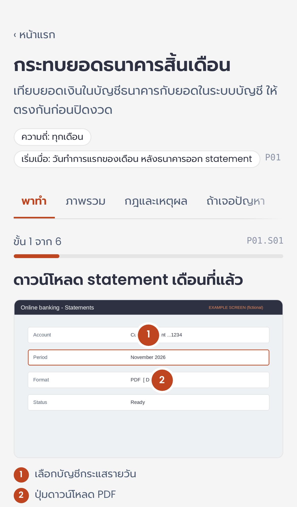
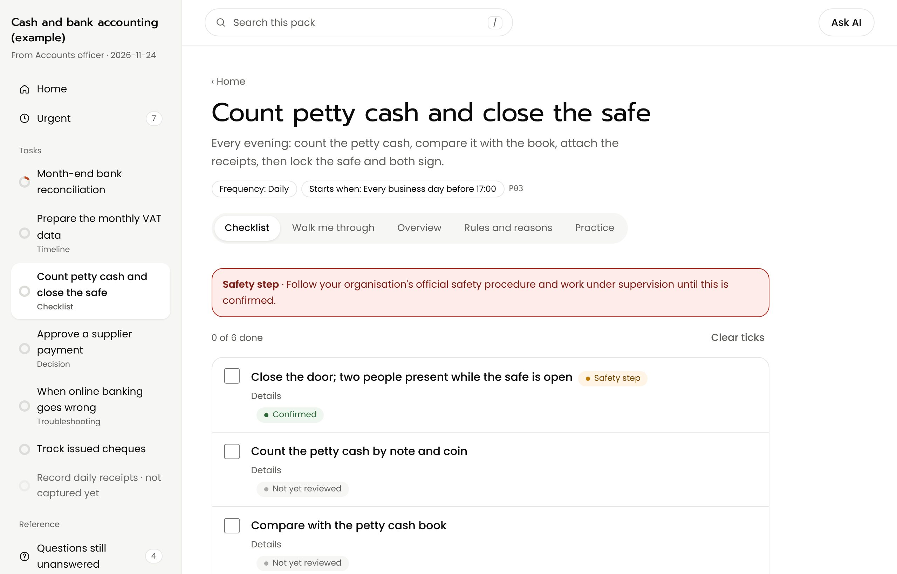
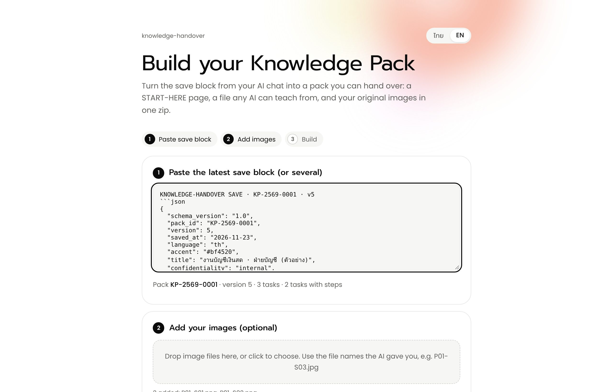

<div align="center">


# knowledge-handover

**คนไปได้ แต่ความรู้ต้องอยู่**

Skill สำหรับ AI ที่สัมภาษณ์คนทำงานว่าทำงานจริงอย่างไร แล้วรวบรวมเป็น **Knowledge Pack** ไฟล์เดียว ให้คนที่มารับงานต่อเปิดดูในเบราว์เซอร์ หรือส่งให้ AI ตัวไหนก็ได้สอนทีละขั้น

[English](README.md) · **ภาษาไทย**

[](https://github.com/phumminbm/knowledge-handover/actions/workflows/ci.yml)
[](https://github.com/phumminbm/knowledge-handover/releases/latest)
[](LICENSE)

[ติดตั้ง](#ติดตั้ง) · [ใช้งานอย่างไร](#ใช้งานอย่างไร) · [ดูตัวอย่าง Pack](https://phumminbm.github.io/knowledge-handover/example/START-HERE.html) · [Pack Builder](https://phumminbm.github.io/knowledge-handover/) · [แก้ปัญหา](#ถ้าใช้แล้วติดปัญหา)


</div>

## ทำไมต้องใช้

ตอนมีคนลาออก เอกสารส่งงานมักเขียนแบบรีบ ๆ ขาดกรณีพิเศษ และไม่มีใครรู้ว่าส่วนไหนยังใช้ได้จริง knowledge-handover ให้ AI เป็นคนถามแทน

- **ง่ายสำหรับผู้ส่งงาน:** เริ่มด้วยประโยคเดียว ตอบด้วยการกดเลือกเป็นส่วนใหญ่ หยุดแล้วกลับมาทำต่อเมื่อไหร่ก็ได้
- **ง่ายสำหรับผู้รับงาน:** ไม่ต้องติดตั้งอะไร เปิด `START-HERE.html` ได้เลย หรือแนบ Pack ในแชต AI แล้วพิมพ์ว่า *"สอนงานจาก pack นี้"*
- **ใช้ได้กับทุกงาน:** งานออฟฟิศ งานหน้างาน งานดูแลผู้ป่วย ใช้ได้ทั้งภาพหน้าจอและภาพถ่ายหน้างาน
- **ใช้ได้กับทุก AI:** Claude, ChatGPT, Codex, Gemini, Cursor, Copilot รวมถึงแชตแพ็กเกจฟรี
- **ซื่อตรงกับข้อมูล:** ทุกข้อมีสถานะ **ยืนยันแล้ว**, **ยังไม่ได้ตรวจ**, **รอยืนยัน** หรือ **ยังไม่มีคำตอบ** จะได้ไม่มีใครเข้าใจผิดว่าสิ่งที่ AI เดาเป็นกฎจริง
- **ข้อมูลอยู่กับคุณ:** ไม่มีเซิร์ฟเวอร์ ไม่ต้องสมัครบัญชี ไม่มีการติดตามการใช้งาน ดูรายละเอียดที่ [PRIVACY.md](PRIVACY.md)

<table>
<tr>
<td width="62%"></td>
<td width="38%"></td>
</tr>
<tr>
<td>เรื่องด่วนขึ้นก่อน ตามด้วยงานทั้งหมดของตำแหน่ง</td>
<td>เปิดบนมือถือได้ ไม่ต้องต่อเน็ต</td>
</tr>
</table>

### แต่ละงานได้หน้าตาที่เหมาะกับลักษณะงาน

AI จะเลือกรูปแบบหน้าและวาดไดอะแกรมให้ทุกงานเอง แล้วบอกผู้ส่งงานว่าเลือกอะไร ผู้ส่งงานไม่ต้องเลือกเอง ถ้าอยากได้แบบอื่นค่อยบอก ผู้รับงานกดกลับไปดูแบบพาทำทีละขั้นได้เสมอ

| รูปแบบ | เหมาะกับงานแบบ |
|---|---|
| **พาทำทีละขั้น** | งานในโปรแกรม พร้อมภาพหน้าจอจริงของผู้ส่งงานและหมุดตัวเลข |
| **เช็กลิสต์** | ส่งเวร เปิดปิดร้าน ตรวจเครื่องตามรอบ (ขั้นความปลอดภัยขึ้นก่อน) |
| **ไทม์ไลน์** | ปิดงวดสิ้นเดือน ทำเงินเดือน งานที่ทำตามวันเวลา |
| **ช่วยตัดสินใจ** | งานอนุมัติ งานที่ "แล้วแต่กรณี" แสดงหลักที่ใช้ตัดสินก่อน แล้วถามทีละข้อ |
| **เจออาการอะไร** | งานซ่อม งาน IT งาน on-call เริ่มจากอาการที่เจอ |

ค้นหาได้ทั้ง Pack ด้วยปุ่ม `/` หรือ Ctrl+K และกดเรียนต่อจากจุดเดิมได้จากหน้าแรก



## ติดตั้ง

### Claude (claude.ai และแอปเดสก์ท็อป ใช้ได้ทุกแพ็กเกจรวมถึงแบบฟรี)

1. ดาวน์โหลด **[knowledge-handover.zip](https://github.com/phumminbm/knowledge-handover/releases/latest/download/knowledge-handover.zip)**
2. ใน Claude ไปที่ **Customize › Skills** แล้วอัปโหลดไฟล์ zip
3. เปิด **Code execution** ไว้ เพื่อให้ Claude สร้าง Pack ให้ได้เอง

### ChatGPT (workspace ที่มีเมนู Skills)

ดาวน์โหลด **[knowledge-handover.zip](https://github.com/phumminbm/knowledge-handover/releases/latest/download/knowledge-handover.zip)** ไฟล์เดียวกัน แล้วไปที่ **Skills › Create › Upload from your computer**

### แชต AI อื่น ๆ (Gemini, ChatGPT ฟรี, Copilot chat ฯลฯ)

ดาวน์โหลด **[PROMPT.md](https://github.com/phumminbm/knowledge-handover/releases/latest/download/PROMPT.md)** แล้ววางไว้ตอนเริ่มแชต หรือใส่ไว้ใน Gem, Project หรือ custom instructions AI จะให้ save block มา แล้วคุณนำไปสร้าง Pack ใน [Pack Builder](https://phumminbm.github.io/knowledge-handover/)

<details>
<summary><b>Claude Code</b></summary>

```text
/plugin marketplace add phumminbm/knowledge-handover
/plugin install knowledge-handover@knowledge-handover
```

ถ้าใช้ Claude Code 2.1.275 ขึ้นไป พิมพ์คำสั่งเดียวได้เลย

```text
/plugin install knowledge-handover --marketplace phumminbm/knowledge-handover
```

ถ้าอยากให้อัปเดตอัตโนมัติ: พิมพ์ `/plugin` เปิด **Marketplaces** เลือก **knowledge-handover** แล้วกด **Enable auto-update**

</details>

<details>
<summary><b>Cursor, GitHub Copilot, Gemini CLI, Windsurf, Cline</b> และโปรแกรมอื่นที่รองรับ Agent Skills</summary>

```bash
npx skills add phumminbm/knowledge-handover
```

อัปเดตภายหลังด้วย `npx skills update knowledge-handover`

</details>

<details>
<summary><b>Codex</b></summary>

```bash
codex plugin marketplace add phumminbm/knowledge-handover
codex plugin add knowledge-handover@knowledge-handover
```

</details>

<details>
<summary><b>Gemini CLI</b> (แบบ native)</summary>

```bash
gemini skills install https://github.com/phumminbm/knowledge-handover --path skills/knowledge-handover
```

</details>

<details>
<summary><b>ติดตั้งเอง</b></summary>

คัดลอกโฟลเดอร์ `skills/knowledge-handover/` ไปไว้ในโฟลเดอร์ skills ของโปรแกรม เช่น `~/.claude/skills/knowledge-handover/`

</details>

## ใช้งานอย่างไร

### 1. ผู้ส่งงานเล่า

พิมพ์ประมาณนี้ จะใช้ภาษาอะไรก็ได้

> *"อีก 2 อาทิตย์จะลาออก ช่วยเก็บงานส่งต่อให้หน่อย"*
>
> *"ช่วยทำคู่มือออกใบกำกับภาษีในโปรแกรมให้คนใหม่ ฉันมีรูปหน้าจอ"*
>
> *"I'm leaving next month, help me hand over my work."*

AI จะทำความรู้จักงานของคุณ ขอภาพหน้าจอ ไฟล์ที่ใช้ทำงาน ตัวอย่างงานที่ทำเสร็จ หรือลิงก์ ทุกครั้งที่คุณพูดถึง (แล้วอ่านเอง จะได้ถามคุณน้อยลง) ถามเรื่องที่มักลืมเขียน (กรณีพิเศษ กำหนดส่ง ต้องติดต่อใคร) วาดภาพสิ่งที่เข้าใจให้คุณตรวจ และให้ **save block** ทุกครั้งที่จบรอบ เก็บ save block ไว้ แล้ววางในแชตใหม่เมื่ออยากทำต่อ

### 2. สร้าง Pack

- ถ้า AI รันโค้ดได้ (Claude ที่เปิด Code execution, Claude Code, Codex, Gemini CLI) AI จะสร้างไฟล์ zip ให้เอง
- ถ้ารันโค้ดไม่ได้ ให้เปิด **[Pack Builder](https://phumminbm.github.io/knowledge-handover/)** วาง save block ล่าสุด ลากรูปใส่ แล้วดาวน์โหลด zip ทุกอย่างทำงานในเบราว์เซอร์ของคุณ ไม่มีการอัปโหลดข้อมูลไปไหน



### 3. ผู้รับงานเรียน

แนบไฟล์ zip (หรือแค่ `PACK-FOR-AI.md`) ในแชต AI ตัวไหนก็ได้ แล้วพิมพ์ว่า *"สอนงานจาก pack นี้"* AI จะเล่าภาพรวมของงานและเรื่องด่วนก่อน แล้วพาทำทีละงานด้วยภาพจริง พร้อมอธิบายว่าแต่ละขั้นทำไปเพื่ออะไร ถ้าไม่ใช้ AI ก็เปิด `START-HERE.html` ในเบราว์เซอร์ได้เลย **[เปิดดูตัวอย่าง Pack](https://phumminbm.github.io/knowledge-handover/example/START-HERE.html)** เพื่อดูว่าผู้รับงานจะได้อะไร

## ใน Pack มีอะไรบ้าง

```text
knowledge-handover_KP-2569-0042_2026-11-30.zip
├── START-HERE.html      เรื่องด่วน แผนผังงาน วิธีทำทีละขั้นพร้อมภาพจริง แบบทดสอบ
├── PACK-FOR-AI.md       ทุกอย่างในไฟล์เดียว พร้อมวิธีสอนสำหรับ AI ตัวไหนก็ได้
├── handover-status.md   งานค้าง กำหนดส่ง คนที่รออยู่ บัญชีที่ต้องโอนสิทธิ์
├── processes/…          แยกโฟลเดอร์ละงาน: ขั้นตอน กฎ การแก้ปัญหา สถานการณ์ตัวอย่าง
├── visuals/             ภาพต้นฉบับ ไม่มีการแก้ไข
├── open-questions.md    เรื่องที่ยังไม่มีคำตอบ และควรถามใคร
└── knowledge.json       ข้อมูลต้นทางทั้งหมด วางกลับเข้าแชตเพื่ออัปเดต Pack ได้
```

## ความเป็นส่วนตัวและความปลอดภัย

- ไม่บันทึกรหัสผ่าน คีย์ หรือรหัส OTP ถ้าเผลอวางรหัสลงในแชต AI จะไม่เก็บไว้และบอกให้คุณเปลี่ยนรหัส
- ข้อมูลติดต่อส่วนตัว ข้อมูลสุขภาพ เงินเดือน หรือราคา จะไม่คัดลอกลง Pack แต่จะชี้ไปที่ระบบที่เก็บข้อมูลจริง (CRM ระบบผู้ป่วย ทะเบียน) และ AI จะขอให้คุณปิดข้อมูลส่วนตัวในรูปก่อน
- ไม่สร้างภาพหน้าจอปลอม และไม่ติดสถานะยืนยันแล้วให้สิ่งที่ AI เดาเอง
- `START-HERE.html` และ Pack Builder ไม่เชื่อมต่ออินเทอร์เน็ตเลย และถือว่าเนื้อหาใน Pack ไม่น่าไว้ใจ จึงรันโค้ดแฝงจาก Pack ที่ถูกแก้ไขไม่ได้

Pack มีทุกอย่างที่ผู้ส่งงานเล่าไว้ จึงควรเก็บและส่งต่อผ่านช่องทางที่องค์กรอนุญาตเท่านั้น รายละเอียดอยู่ที่ [PRIVACY.md](PRIVACY.md) · แจ้งช่องโหว่แบบไม่เปิดเผย: [SECURITY.md](SECURITY.md)

## ถ้าใช้แล้วติดปัญหา

| เจออะไร | ทำอย่างไร |
|---|---|
| AI บอกว่าสร้างไฟล์ zip ไม่ได้ | AI ตัวนั้นรันโค้ดไม่ได้ ให้ใช้ [Pack Builder](https://phumminbm.github.io/knowledge-handover/) กับ save block ล่าสุด ถ้าใช้ claude.ai ให้เปิด Code execution แล้ว Claude จะสร้างให้ได้ |
| เปิดแชตใหม่แล้ว AI จำงานเดิมไม่ได้ | แชตไม่จำข้ามห้อง ให้วาง save block ล่าสุด AI จะทำต่อจากตรงนั้น |
| save block ยาวเกินจนแชตรับไม่ไหว | บอก AI ให้แบ่งเป็นหลายก้อน แล้ววางทุกก้อนลงใน Pack Builder พร้อมกัน ระบบจะรวมให้เอง |
| รูปไม่ขึ้นใน Pack | ตั้งชื่อรูปตามที่ AI บอก (เช่น `P01-S03.jpg`) แล้วลากใส่ใน Pack Builder |
| แชตของผู้รับงานไม่รับไฟล์ zip | แนบไฟล์ `PACK-FOR-AI.md` ที่อยู่ใน zip แทน |
| claude.ai แจ้งว่าไฟล์ zip มีไฟล์ข้างในมากเกินไป | คุณอัปโหลด zip ของทั้ง repo (ปุ่ม "Download ZIP" บน GitHub) ให้ใช้ `knowledge-handover.zip` จากหน้า [Releases](https://github.com/phumminbm/knowledge-handover/releases/latest) แทน |

ยังติดอยู่? [เปิด issue](https://github.com/phumminbm/knowledge-handover/issues/new/choose) ได้ทั้งภาษาไทยและอังกฤษ

## สำหรับนักพัฒนา

โครงสร้าง repo คำสั่ง build และ test อยู่ใน [README ภาษาอังกฤษ](README.md#for-developers), [CONTRIBUTING.md](CONTRIBUTING.md) และ [AGENTS.md](AGENTS.md) (สำหรับ AI ที่เข้ามาแก้โค้ด) ส่วนรายการการเปลี่ยนแปลงอยู่ที่ [CHANGELOG.md](CHANGELOG.md)

## License

MIT (ดู [LICENSE](LICENSE)) ส่วนประกอบที่นำมารวมไว้ใช้ license ของตัวเอง ได้แก่ diagram engine ที่ดัดแปลงจาก [cathrynlavery/diagram-design](https://github.com/cathrynlavery/diagram-design) (ดู [`diagram/THIRD_PARTY_LICENSES.md`](skills/knowledge-handover/diagram/THIRD_PARTY_LICENSES.md)) และฟอนต์ Poppins กับ Prompt ภายใต้ [SIL Open Font License](skills/knowledge-handover/assets/fonts/OFL.txt)
