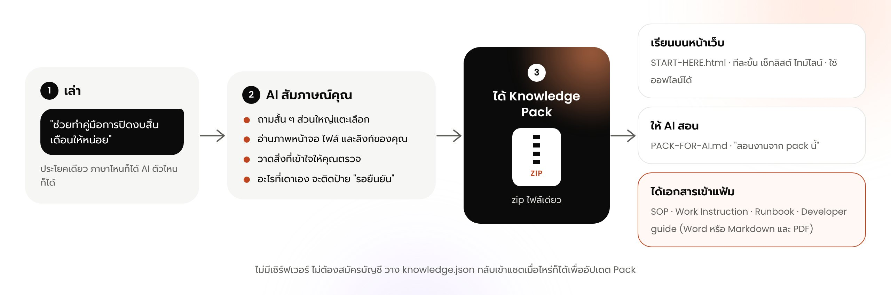
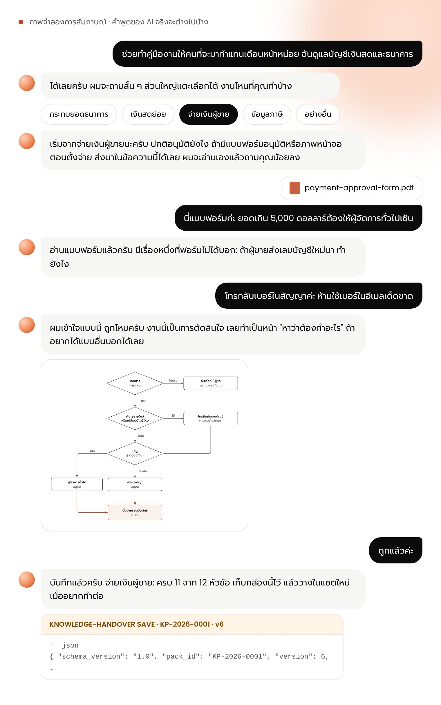
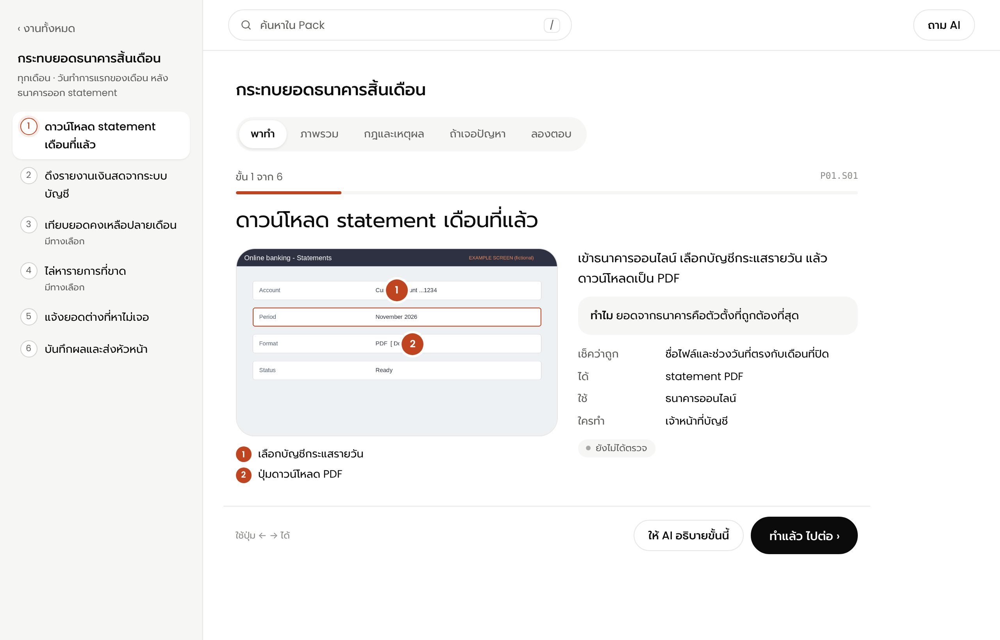
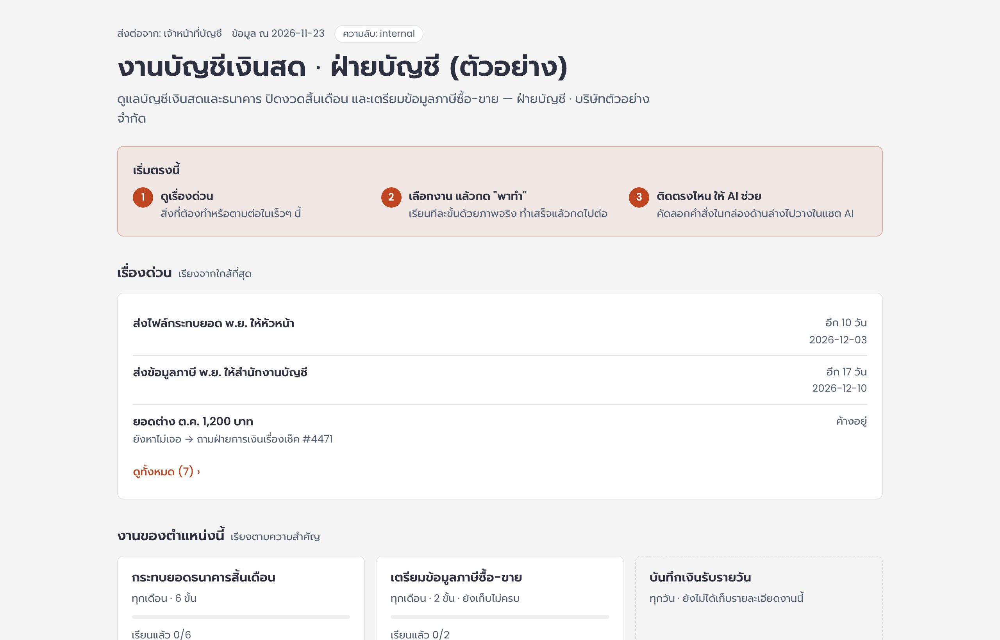
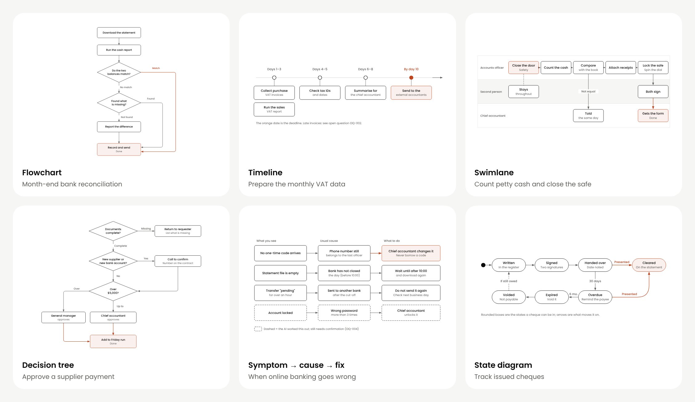

<div align="center">


# knowledge-handover

**ความรู้ในหัว ส่งต่อได้ทุกเมื่อ**

Skill สำหรับ AI ที่สัมภาษณ์คนทำงานว่าทำงานจริงอย่างไร แล้วรวบรวมเป็น **Knowledge Pack** ไฟล์เดียว ได้ทั้งหน้าเว็บให้คนอื่นเปิดเรียนในเบราว์เซอร์ ไฟล์ให้ AI ตัวไหนก็ได้สอนทีละขั้น และเอกสารแบบที่สายงานคุณใช้ (SOP, Work Instruction, Runbook หรือ Developer guide)

[English](README.md) · **ภาษาไทย**

[](https://github.com/phumminbm/knowledge-handover/actions/workflows/ci.yml)
[](https://github.com/phumminbm/knowledge-handover/releases/latest)
[](LICENSE)

[ใช้งานอย่างไร](#ใช้งานอย่างไร) · [จะได้อะไร](#สิ่งที่คุณจะได้) · [ตัวอย่าง](#ดูตัวอย่าง) · [ติดตั้ง](#ติดตั้ง) · [Pack Builder](https://phumminbm.github.io/knowledge-handover/) · [แก้ปัญหา](#ถ้าใช้แล้วติดปัญหา)



</div>

## ทำไมต้องใช้

คู่มืองานส่วนใหญ่มักเขียนแบบรีบ ๆ ขาดกรณีพิเศษ และไม่มีใครรู้ว่าส่วนไหนยังใช้ได้จริง ไม่ว่าจะเป็นคู่มือสำหรับพนักงานใหม่ โน้ตสำหรับคนที่มาช่วยงานตอนลา SOP ของทีม หรือเอกสารส่งต่องาน knowledge-handover ให้ AI เป็นคนถามแทน

- **ง่ายสำหรับผู้ส่งงาน:** เริ่มด้วยประโยคเดียว ตอบด้วยการกดเลือกเป็นส่วนใหญ่ หยุดแล้วกลับมาทำต่อเมื่อไหร่ก็ได้
- **ง่ายสำหรับผู้รับงาน:** ไม่ต้องติดตั้งอะไร เปิด `START-HERE.html` ได้เลย หรือแนบ Pack ในแชต AI แล้วพิมพ์ว่า *"สอนงานจาก pack นี้"*
- **ใช้ได้กับทุกงาน:** งานออฟฟิศ งานหน้างาน งานดูแลผู้ป่วย วิศวกรรม IT operations และซอฟต์แวร์ ใช้ได้ทั้งภาพหน้าจอ ภาพถ่ายหน้างาน หรือคำสั่งที่พิมพ์จริง
- **ได้เอกสารแบบที่สายงานคุณใช้:** ทุกงานมีเอกสารให้ด้วย เป็น SOP, Work Instruction, Runbook หรือ Developer guide (ไฟล์ Word หรือ Markdown และหน้าที่พิมพ์หรือบันทึกเป็น PDF ได้)
- **ใช้ได้กับทุก AI:** Claude, ChatGPT, Codex, Gemini, Cursor, Copilot รวมถึงแชตแพ็กเกจฟรี
- **ซื่อตรงกับข้อมูล:** ทุกข้อมีสถานะ **ยืนยันแล้ว**, **ยังไม่ได้ตรวจ**, **รอยืนยัน** หรือ **ยังไม่มีคำตอบ** จะได้ไม่มีใครเข้าใจผิดว่าสิ่งที่ AI เดาเป็นกฎจริง
- **ข้อมูลอยู่กับคุณ:** ไม่มีเซิร์ฟเวอร์ ไม่ต้องสมัครบัญชี ไม่มีการติดตามการใช้งาน ดูรายละเอียดที่ [PRIVACY.md](PRIVACY.md)

## ใช้งานอย่างไร

### 1. ผู้ส่งงานเล่า

พิมพ์ประมาณนี้ จะใช้ภาษาอะไรก็ได้

> *"ช่วยทำคู่มืองานใบเสนอราคาให้ทีมหน่อย"*
>
> *"ช่วยทำคู่มือออกใบกำกับภาษีในโปรแกรมให้คนใหม่ ฉันมีรูปหน้าจอ"*
>
> *"อีก 2 อาทิตย์จะลาออก ช่วยเก็บงานส่งต่อให้หน่อย"*
>
> *"I'm leaving next month, help me hand over my work."*

AI จะทำความรู้จักงานของคุณ ขอภาพหน้าจอ ไฟล์ที่ใช้ทำงาน ตัวอย่างงานที่ทำเสร็จ หรือลิงก์ ทุกครั้งที่คุณพูดถึง (แล้วอ่านเอง จะได้ถามคุณน้อยลง) ถามเรื่องที่มักลืมเขียน (กรณีพิเศษ กำหนดส่ง ต้องติดต่อใคร) วาดภาพสิ่งที่เข้าใจให้คุณตรวจ และให้ **save block** ทุกครั้งที่จบรอบ เก็บ save block ไว้ แล้ววางในแชตใหม่เมื่ออยากทำต่อ



<sub>ภาพจำลองให้เห็นลำดับการคุย ไม่ใช่แชตจริง คำพูดของ AI จริงจะต่างไปบ้าง</sub>

### 2. สร้าง Pack

- ถ้า AI รันโค้ดได้ (Claude ที่เปิด Code execution, Claude Code, Codex, Gemini CLI) AI จะสร้างไฟล์ zip ให้เอง
- ถ้ารันโค้ดไม่ได้ ให้เปิด **[Pack Builder](https://phumminbm.github.io/knowledge-handover/)** วาง save block ล่าสุด ลากรูปใส่ แล้วดาวน์โหลด zip ทุกอย่างทำงานในเบราว์เซอร์ของคุณ ไม่มีการอัปโหลดข้อมูลไปไหน


### 3. ผู้รับงานเรียน

แนบไฟล์ zip (หรือแค่ `PACK-FOR-AI.md`) ในแชต AI ตัวไหนก็ได้ แล้วพิมพ์ว่า *"สอนงานจาก pack นี้"* AI จะเล่าภาพรวมของงานก่อน (ถ้าเป็นการส่งต่องาน จะเล่าเรื่องด่วนด้วย) แล้วพาทำทีละงานด้วยภาพจริง พร้อมอธิบายว่าแต่ละขั้นทำไปเพื่ออะไร ถ้าไม่ใช้ AI ก็เปิด `START-HERE.html` ในเบราว์เซอร์ได้เลย **[เปิดดูตัวอย่าง Pack](https://phumminbm.github.io/knowledge-handover/example/START-HERE.html)** เพื่อดูว่าผู้รับงานจะได้อะไร

## สิ่งที่คุณจะได้

สัมภาษณ์ครั้งเดียว ได้ 4 อย่างใน Pack เดียว: หน้าเว็บสำหรับเรียนงาน ไดอะแกรม แบบฝึกหัด และเอกสารแบบที่สายงานคุณใช้

### หน้าเว็บสำหรับเรียนงาน จัดหน้าตาให้เหมาะกับแต่ละงาน



<table>
<tr>
<td width="62%"></td>
<td width="38%"></td>
</tr>
<tr>
<td>เรื่องด่วนขึ้นก่อน ตามด้วยงานทั้งหมดของตำแหน่ง</td>
<td>เปิดบนมือถือได้ ไม่ต้องต่อเน็ต</td>
</tr>
</table>

AI จะเลือกรูปแบบหน้าและวาดไดอะแกรมให้ทุกงานเอง แล้วบอกผู้ส่งงานว่าเลือกอะไร ผู้ส่งงานไม่ต้องเลือกเอง ถ้าอยากได้แบบอื่นค่อยบอก ผู้รับงานกดกลับไปดูแบบพาทำทีละขั้นได้เสมอ

| รูปแบบ | เหมาะกับงานแบบ |
|---|---|
| **พาทำทีละขั้น** | งานในโปรแกรม พร้อมภาพหน้าจอจริงของผู้ส่งงานและหมุดตัวเลข |
| **เช็กลิสต์** | ส่งเวร เปิดปิดร้าน ตรวจเครื่องตามรอบ (ขั้นความปลอดภัยขึ้นก่อน) |
| **ไทม์ไลน์** | ปิดงวดสิ้นเดือน ทำเงินเดือน งานที่ทำตามวันเวลา |
| **ช่วยตัดสินใจ** | งานอนุมัติ งานที่ "แล้วแต่กรณี" แสดงหลักที่ใช้ตัดสินก่อน แล้วถามทีละข้อ |
| **เจออาการอะไร** | งานซ่อม งาน IT งาน on-call เริ่มจากอาการที่เจอ |

ค้นหาได้ทั้ง Pack ด้วยปุ่ม `/` หรือ Ctrl+K และกดเรียนต่อจากจุดเดิมได้จากหน้าแรก


### AI วาดไดอะแกรมให้เข้ากับลักษณะงาน

งานที่มีทางเลือกใช่/ไม่ใช่ได้ผังขั้นตอน งานตามปฏิทินได้ไทม์ไลน์ งานที่ส่งต่อกันหลายคนได้ผังแบ่งช่องตามคน (swimlane) งานอนุมัติได้ผังตัดสินใจ งานแก้ปัญหาได้ตาราง อาการ → สาเหตุ → วิธีแก้ และงานที่มีสถานะได้ผังสถานะ ส่วนไหนที่ AI สรุปเองจะวาดเป็นเส้นประจนกว่าจะมีคนยืนยัน



### ฝึกทำ บนหน้าเว็บหรือกับ AI

ทุกงานมีแบบฝึกหัดจากสถานการณ์จริงได้ ทุกคำตอบบอกเหตุผล


ถ้าใช้กับ AI ผู้รับงานแนบไฟล์ zip (หรือ `PACK-FOR-AI.md`) แล้วพิมพ์ว่า *"สอนงานจาก pack นี้"* ส่วนบนของ `PACK-FOR-AI.md` บอก AI ว่าต้องสอนอย่างไร: เล่าภาพรวมของงาน ถามระดับของผู้เรียน พาทำทีละขั้นแล้วรอให้ตอบว่า "เสร็จแล้ว" ถามว่าเป็นกรณีไหนเมื่อถึงทางเลือก อ้างรหัสของแต่ละข้อ เตือนทุกครั้งที่ใช้ข้อที่ยังไม่ได้ยืนยัน ใช้แบบฝึกหัด และบอกตรง ๆ เมื่อ Pack ไม่มีคำตอบ

### เอกสารแบบที่แต่ละสายงานใช้

ทุกงานใน Pack ถูกเขียนเป็นเอกสารแบบที่สายงานนั้นใช้ด้วย AI เลือกประเภทให้ตามลักษณะงานแล้วบอกคุณ ถ้าอยากได้แบบอื่นบอกได้

| ประเภท | สำหรับ | ได้อะไร |
|---|---|---|
| **SOP** | งานออฟฟิศ งานบริการ งานธุรการ งานดูแล | ไฟล์ Word + หน้าพร้อมพิมพ์ (PDF) |
| **Work Instruction** | วิศวกรรม ซ่อมบำรุง การผลิต ห้องแล็บ | ไฟล์ Word + หน้าพร้อมพิมพ์: ความปลอดภัยและ PPE มาก่อน เครื่องมือ ค่าสเปกและค่าเผื่อ จุดตรวจคุณภาพ ช่องลงนาม |
| **Runbook** | IT operations, DevOps, on-call | Markdown สำหรับ repo หรือ wiki + หน้าพร้อมพิมพ์: คำสั่งที่ใช้จริง ผลที่ควรเห็น วิธีย้อนกลับ การส่งต่อปัญหา rollback |
| **Developer guide** | พัฒนาซอฟต์แวร์ | Markdown + หน้าพร้อมพิมพ์: สิ่งที่ต้องมีก่อน คำสั่งติดตั้ง ข้อตกลงของทีม ปัญหาที่พบบ่อย |

ทุกแบบมีขั้นตอนตามลักษณะงาน (ทีละขั้นพร้อมภาพหน้าจอ เช็กลิสต์ ไทม์ไลน์ ตารางตัดสินใจ หรือตารางอาการ) และในฉบับพิมพ์มีไดอะแกรมด้วย ช่องเลขที่เอกสาร เจ้าของ วันที่มีผล ผู้อนุมัติ และช่องลงนาม เว้นว่างไว้ให้องค์กรกรอกเอง สถานะเป็น "ฉบับร่าง" จนกว่าทุกอย่างจะยืนยันแล้ว และข้อที่ AI สรุปเองมีป้ายบอกชัด ข้อมูลลับไม่หลุดเข้าไป: อะไรที่ดูเหมือนรหัสผ่าน คีย์ หรือ token จะถูกแทนด้วย `<REDACTED>` ในทุกไฟล์ และระบบจะบอกให้คุณเปลี่ยนรหัสนั้น ถ้าองค์กรมีแม่แบบของตัวเอง ส่งให้ AI ระหว่างสัมภาษณ์ได้ AI ที่แก้เอกสารได้จะกรอกแม่แบบนั้นให้ด้วย


### ไฟล์ทั้งหมดใน Pack

```text
knowledge-handover_KP-2569-0042_2026-11-30.zip
├── START-HERE.html      เรื่องด่วน แผนผังงาน วิธีทำทีละขั้นพร้อมภาพจริง แบบทดสอบ
├── PACK-FOR-AI.md       ทุกอย่างในไฟล์เดียว พร้อมวิธีสอนสำหรับ AI ตัวไหนก็ได้
├── handover-status.md   เฉพาะตอนส่งต่องาน: งานค้าง กำหนดส่ง บัญชีที่ต้องโอนสิทธิ์
├── processes/…          แยกโฟลเดอร์ละงาน: ขั้นตอน กฎ การแก้ปัญหา สถานการณ์ตัวอย่าง
├── documents/           ทุกงานเป็น SOP, Work Instruction, Runbook หรือ Developer guide (.docx หรือ .md และหน้าพร้อมพิมพ์)
├── visuals/             ภาพต้นฉบับ ไม่มีการแก้ไข
├── open-questions.md    เรื่องที่ยังไม่มีคำตอบ และควรถามใคร
└── knowledge.json       ข้อมูลต้นทางทั้งหมด วางกลับเข้าแชตเพื่ออัปเดต Pack ได้
```

## ดูตัวอย่าง

มี Pack ตัวอย่างสมมติ 2 ชุด เป็นภาษาอังกฤษ ไม่ต้องติดตั้งอะไร เปิดในเบราว์เซอร์ได้เลย

### งานบัญชีเงินสดและธนาคาร (6 งาน ครบ 5 รูปแบบหน้า ไดอะแกรม 6 แบบ)

| อยากดูอะไร | เปิดที่นี่ |
|---|---|
| หน้าที่ผู้รับงานจะได้ | [START-HERE.html](https://phumminbm.github.io/knowledge-handover/example/START-HERE.html) |
| **ทีละขั้น** พร้อมภาพหน้าจอจริงและหมุดตัวเลข | [Month-end bank reconciliation](https://phumminbm.github.io/knowledge-handover/example/START-HERE.html#/task/P01/walk/P01.S01) |
| **ไทม์ไลน์** | [Prepare the monthly VAT data](https://phumminbm.github.io/knowledge-handover/example/START-HERE.html#/task/P02) |
| **เช็กลิสต์** ขั้นความปลอดภัยขึ้นก่อน | [Count petty cash and close the safe](https://phumminbm.github.io/knowledge-handover/example/START-HERE.html#/task/P03) |
| **หาว่าต้องทำอะไร** | [Approve a supplier payment](https://phumminbm.github.io/knowledge-handover/example/START-HERE.html#/task/P04) |
| **เจออาการอะไร** | [When online banking goes wrong](https://phumminbm.github.io/knowledge-handover/example/START-HERE.html#/task/P05) |
| แบบฝึกหัด | [Approve a supplier payment › Practice](https://phumminbm.github.io/knowledge-handover/example/START-HERE.html#/task/P04/quiz) |
| เรื่องที่ Pack ยังไม่มีคำตอบ | [Open questions](https://phumminbm.github.io/knowledge-handover/example/START-HERE.html#/questions) |
| เอกสาร SOP | [หน้าพร้อมพิมพ์](https://phumminbm.github.io/knowledge-handover/example/documents/P04-supplier-payment-approval.html) · [ไฟล์ Word](https://phumminbm.github.io/knowledge-handover/example/documents/P04-supplier-payment-approval.docx) |
| ไฟล์ทั้งหมดใน Pack | [example-pack.zip](https://phumminbm.github.io/knowledge-handover/example/example-pack.zip) · [`knowledge.json` ที่ AI เขียน](examples/bank-reconciliation/knowledge.json) |

### งาน platform engineering (Runbook, Developer guide, Work Instruction)

| อยากดูอะไร | เปิดที่นี่ |
|---|---|
| หน้าที่ผู้รับงานจะได้ | [START-HERE.html](https://phumminbm.github.io/knowledge-handover/example-it/START-HERE.html) |
| Runbook ที่มีคำสั่งจริง ผลที่ควรเห็น และวิธีย้อนกลับ | [หน้าพร้อมพิมพ์](https://phumminbm.github.io/knowledge-handover/example-it/documents/P01-restore-database.html) · [Markdown](https://phumminbm.github.io/knowledge-handover/example-it/documents/P01-restore-database.md) |
| Developer guide | [หน้าพร้อมพิมพ์](https://phumminbm.github.io/knowledge-handover/example-it/documents/P02-local-setup.html) · [Markdown](https://phumminbm.github.io/knowledge-handover/example-it/documents/P02-local-setup.md) |
| Work Instruction ที่มี PPE เครื่องมือ และค่าแรงขัน | [หน้าพร้อมพิมพ์](https://phumminbm.github.io/knowledge-handover/example-it/documents/P03-replace-disk.html) · [ไฟล์ Word](https://phumminbm.github.io/knowledge-handover/example-it/documents/P03-replace-disk.docx) |
| Runbook สำหรับแก้ปัญหา | [START-HERE › What's wrong?](https://phumminbm.github.io/knowledge-handover/example-it/START-HERE.html#/task/P04) · [Markdown](https://phumminbm.github.io/knowledge-handover/example-it/documents/P04-backup-failures.md) |
| ไฟล์ทั้งหมดใน Pack | [example-pack.zip](https://phumminbm.github.io/knowledge-handover/example-it/example-pack.zip) · [`knowledge.json` ที่ AI เขียน](examples/it-operations/knowledge.json) |

## ติดตั้ง

### Claude (claude.ai และแอปเดสก์ท็อป ใช้ได้ทุกแพ็กเกจรวมถึงแบบฟรี)

1. ดาวน์โหลด **[knowledge-handover.zip](https://github.com/phumminbm/knowledge-handover/releases/latest/download/knowledge-handover.zip)**
2. ใน Claude ไปที่ **Customize › Skills** แล้วอัปโหลดไฟล์ zip
3. เปิด **Code execution** ไว้ เพื่อให้ Claude สร้าง Pack ให้ได้เอง

### ChatGPT (workspace ที่มีเมนู Skills)

ดาวน์โหลด **[knowledge-handover.zip](https://github.com/phumminbm/knowledge-handover/releases/latest/download/knowledge-handover.zip)** ไฟล์เดียวกัน แล้วไปที่ **Skills › Create › Upload from your computer**

### แชต AI อื่น ๆ (Gemini, ChatGPT ฟรี, Copilot chat ฯลฯ)

ดาวน์โหลด **[PROMPT.md](https://github.com/phumminbm/knowledge-handover/releases/latest/download/PROMPT.md)** แล้ววางไว้ตอนเริ่มแชต หรือใส่ไว้ใน Gem, Project หรือ custom instructions AI จะให้ save block มา แล้วคุณนำไปสร้าง Pack ใน [Pack Builder](https://phumminbm.github.io/knowledge-handover/)

<details>
<summary><b>Claude Code</b></summary>

```text
/plugin marketplace add phumminbm/knowledge-handover
/plugin install knowledge-handover@knowledge-handover
```

ถ้าใช้ Claude Code 2.1.275 ขึ้นไป พิมพ์คำสั่งเดียวได้เลย

```text
/plugin install knowledge-handover --marketplace phumminbm/knowledge-handover
```

ถ้าอยากให้อัปเดตอัตโนมัติ: พิมพ์ `/plugin` เปิด **Marketplaces** เลือก **knowledge-handover** แล้วกด **Enable auto-update**

</details>

<details>
<summary><b>Cursor, GitHub Copilot, Gemini CLI, Windsurf, Cline</b> และโปรแกรมอื่นที่รองรับ Agent Skills</summary>

```bash
npx skills add phumminbm/knowledge-handover
```

อัปเดตภายหลังด้วย `npx skills update knowledge-handover`

</details>

<details>
<summary><b>Codex</b></summary>

```bash
codex plugin marketplace add phumminbm/knowledge-handover
codex plugin add knowledge-handover@knowledge-handover
```

</details>

<details>
<summary><b>Gemini CLI</b> (แบบ native)</summary>

```bash
gemini skills install https://github.com/phumminbm/knowledge-handover --path skills/knowledge-handover
```

</details>

<details>
<summary><b>ติดตั้งเอง</b></summary>

คัดลอกโฟลเดอร์ `skills/knowledge-handover/` ไปไว้ในโฟลเดอร์ skills ของโปรแกรม เช่น `~/.claude/skills/knowledge-handover/`

</details>

## ใช้ Pack กับ AI ของคุณเอง

Pack ไม่ได้เป็นแค่เอกสาร แต่เป็นข้อมูลที่มีโครงสร้าง `knowledge.json` และ `PACK-FOR-AI.md` เก็บทุกขั้นตอน กฎ วิธีเช็ก สถานะยืนยัน และป้าย "ใครทำขั้นนี้ได้" ไว้ครบ ผู้ที่ถือ Pack จึงนำไปตั้งผู้ช่วย AI ให้ทำงานบางส่วนได้ ตามความสามารถของเครื่องมือที่ตัวเองมี ถ้าทำ ให้ใช้เฉพาะข้อที่มีสถานะ **ยืนยันแล้ว** ทำตามป้าย "ใครทำขั้นนี้ได้" และให้คนเป็นผู้อนุมัติทุกครั้งก่อน AI ส่งหรือแก้อะไร

## ความเป็นส่วนตัวและความปลอดภัย

- ไม่บันทึกรหัสผ่าน คีย์ หรือรหัส OTP ถ้าเผลอวางรหัสลงในแชต AI จะไม่เก็บไว้และบอกให้คุณเปลี่ยนรหัส
- ข้อมูลติดต่อส่วนตัว ข้อมูลสุขภาพ เงินเดือน หรือราคา จะไม่คัดลอกลง Pack แต่จะชี้ไปที่ระบบที่เก็บข้อมูลจริง (CRM ระบบผู้ป่วย ทะเบียน) และ AI จะขอให้คุณปิดข้อมูลส่วนตัวในรูปก่อน
- ไม่สร้างภาพหน้าจอปลอม และไม่ติดสถานะยืนยันแล้วให้สิ่งที่ AI เดาเอง
- `START-HERE.html` และ Pack Builder ไม่เชื่อมต่ออินเทอร์เน็ตเลย และถือว่าเนื้อหาใน Pack ไม่น่าไว้ใจ จึงรันโค้ดแฝงจาก Pack ที่ถูกแก้ไขไม่ได้

Pack มีทุกอย่างที่ผู้ส่งงานเล่าไว้ จึงควรเก็บและส่งต่อผ่านช่องทางที่องค์กรอนุญาตเท่านั้น รายละเอียดอยู่ที่ [PRIVACY.md](PRIVACY.md) · แจ้งช่องโหว่แบบไม่เปิดเผย: [SECURITY.md](SECURITY.md)

## ถ้าใช้แล้วติดปัญหา

| เจออะไร | ทำอย่างไร |
|---|---|
| AI บอกว่าสร้างไฟล์ zip ไม่ได้ | AI ตัวนั้นรันโค้ดไม่ได้ ให้ใช้ [Pack Builder](https://phumminbm.github.io/knowledge-handover/) กับ save block ล่าสุด ถ้าใช้ claude.ai ให้เปิด Code execution แล้ว Claude จะสร้างให้ได้ |
| เปิดแชตใหม่แล้ว AI จำงานเดิมไม่ได้ | แชตไม่จำข้ามห้อง ให้วาง save block ล่าสุด AI จะทำต่อจากตรงนั้น |
| save block ยาวเกินจนแชตรับไม่ไหว | บอก AI ให้แบ่งเป็นหลายก้อน แล้ววางทุกก้อนลงใน Pack Builder พร้อมกัน ระบบจะรวมให้เอง |
| รูปไม่ขึ้นใน Pack | ตั้งชื่อรูปตามที่ AI บอก (เช่น `P01-S03.jpg`) แล้วลากใส่ใน Pack Builder |
| แชตของผู้รับงานไม่รับไฟล์ zip | แนบไฟล์ `PACK-FOR-AI.md` ที่อยู่ใน zip แทน |
| claude.ai แจ้งว่าไฟล์ zip มีไฟล์ข้างในมากเกินไป | คุณอัปโหลด zip ของทั้ง repo (ปุ่ม "Download ZIP" บน GitHub) ให้ใช้ `knowledge-handover.zip` จากหน้า [Releases](https://github.com/phumminbm/knowledge-handover/releases/latest) แทน |

ยังติดอยู่? [เปิด issue](https://github.com/phumminbm/knowledge-handover/issues/new/choose) ได้ทั้งภาษาไทยและอังกฤษ

## สำหรับนักพัฒนา

โครงสร้าง repo คำสั่ง build และ test อยู่ใน [README ภาษาอังกฤษ](README.md#for-developers), [CONTRIBUTING.md](CONTRIBUTING.md) และ [AGENTS.md](AGENTS.md) (สำหรับ AI ที่เข้ามาแก้โค้ด) ส่วนรายการการเปลี่ยนแปลงอยู่ที่ [CHANGELOG.md](CHANGELOG.md)

## License

MIT (ดู [LICENSE](LICENSE)) ส่วนประกอบที่นำมารวมไว้ใช้ license ของตัวเอง ได้แก่ diagram engine ที่ดัดแปลงจาก [cathrynlavery/diagram-design](https://github.com/cathrynlavery/diagram-design) (ดู [`diagram/THIRD_PARTY_LICENSES.md`](skills/knowledge-handover/diagram/THIRD_PARTY_LICENSES.md)) และฟอนต์ Poppins กับ Prompt ภายใต้ [SIL Open Font License](skills/knowledge-handover/assets/fonts/OFL.txt)
